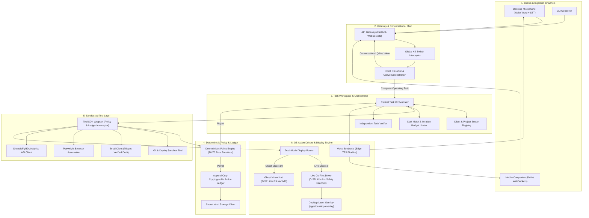

# System Architecture Specification (`.agents/memory/ARCHITECTURE.md`)

> **Protocol Rule:** This document serves as the master living architectural reference across workstations. Any major subsystem addition or architectural modification must be reflected here.

---

## 1. End-to-End System Topology

---

## 2. Core Architectural Subsystems

### 2.1 Conversational Brain & Intent Routing
- **Dual Intent Pipeline:**
  - **Conversational Route:** Directly synthesizes dialogue or answers screen questions without triggering desktop tool manipulation or mouse clicks.
  - **Operational Route:** Passes actionable user instructions to the Task Orchestrator within an isolated `TaskContext`.

### 2.2 Supervised Policy Engine (T0 to T3)
- Pure deterministic Python functions enforcing non-negotiable boundaries:
  - **T0 (Read-Only):** Automatic execution; logged in ledger.
  - **T1 (Local/Reversible):** Automatic execution in isolated branch/sandbox; verified before finish.
  - **T2 (External Impact):** Blocked until signed `ApprovalToken` is issued via on-screen UI button click.
  - **T3 (Irreversible/Financial):** Blocked until signed `ApprovalToken` with attached proof artifacts and source verification is confirmed via on-screen UI button click.
  - **Speech Boundary:** Voice input ("yes", "approve") cannot grant T2/T3 approval tokens.

### 2.3 Immutable Action Ledger
- Hash-chained append-only record storing `(timestamp, task_id, tool_name, risk_tier, client_id, inputs, approval_token, output_summary, entry_hash)`.
- Database role restricted strictly to `INSERT` and `SELECT` operations.

### 2.4 Dual-Mode Execution Mechanics
- **Live Co-Pilot Mode (`DISPLAY=:0`):** Direct interaction on user's primary desktop with active mouse/Escape safety interlock and transient HUD laser crosshairs.
- **Ghost Virtual Lab Mode (`DISPLAY=:99`):** Fully isolated background execution on Xvfb display socket.
