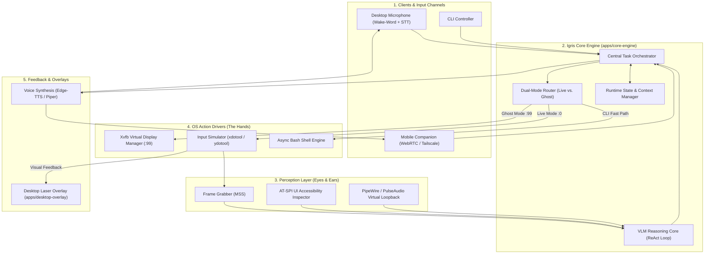

# System Architecture Specification (`ARCHITECTURE.md`)

> **Protocol Rule:** This document serves as the master architectural reference for Igris. Any major subsystem addition or architectural modification must be reflected here.

---

## 1. End-to-End System Topology



---

## 2. Dual-Mode Execution Mechanics

### 2.1 Live Co-Pilot Mode (`DISPLAY=:0`)
* **Target:** Primary physical display for visual collaboration.
* **Safety Interlock:**
  - Background thread monitors physical mouse coordinates.
  - If the user moves the mouse ($\Delta d > 10\text{px}$), `agent.pause()` triggers immediately and yields input control.
* **Visual Feedback:**
  - `apps/desktop-overlay` projects a transient, non-intrusive laser ring or bounding box on the target coordinate before dispatching clicks.

### 2.2 Ghost Mode (`DISPLAY=:99`)
* **Target:** Isolated virtual framebuffer managed by Xvfb.
* **Isolation Guarantees:**
  - Isolated from active windows and user interactions on `:0`.
  - Application commands spawned under `DISPLAY=:99 <cmd> &`.
  - Input events and frame captures routed exclusively through the `:99` display socket.

---

## 3. Autonomous Reasoning Loop (ReAct Loop)

```
[User Task] ───> 1. Observe (Screen Frame + AT-SPI Tree)
                       │
                       ▼
                 2. Reason (Plan Next Action: Click / Type / Scroll / Bash)
                       │
                       ▼
                 3. Act (Dispatch to Virtual or Primary Display)
                       │
                       ▼
                 4. Verify (Compare Result Frame against Target State)
                       │
      [Pending] ◄──────┴──────► [Completed] ───> Voice / Notification Feedback
```

---

## 4. Coordinate Translation & Target Resolution

Models output normalized coordinates in the $[0, 1000]$ range. Translation to display pixels:

$$X_{actual} = \left\lfloor \frac{X_{norm}}{1000} \times \text{Display Width} \right\rfloor$$
$$Y_{actual} = \left\lfloor \frac{Y_{norm}}{1000} \times \text{Display Height} \right\rfloor$$

When AT-SPI accessibility elements are available within the bounding neighborhood, the component center is resolved deterministically:
$$\text{Target Center} = \left( x + \frac{w}{2}, y + \frac{h}{2} \right)$$
