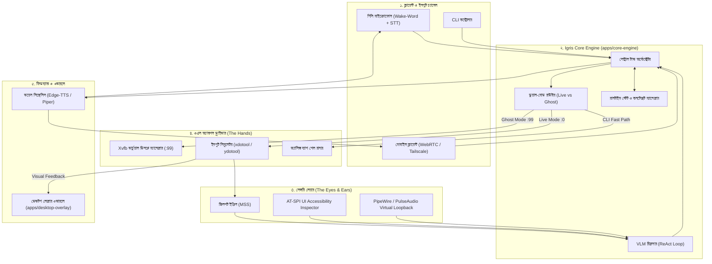

# System Architecture Specification (`ARCHITECTURE.md`)

> **Protocol Rule:** এই ফাইলটি Igris-এর কেন্দ্রীয় আর্কিটেকচারাল ব্লুপ্রিন্ট। সিস্টেমে কোনো মেজর সাবসিস্টেম যুক্ত করার সময় এই স্পেসিফিকেশন আপডেট করতে হবে।

---

## ১. এন্ড-টু-এন্ড সিস্টেম টপোলজি (End-to-End System Topology)



---

## ২. ডুয়াল-মোড এক্সিকিউশন মেকানিক্স (Dual-Mode Execution Mechanics)

### ২.১ লাইভ কো-পাইলট মোড (`DISPLAY=:0`)
* **টার্গেট:** ফিজিক্যাল ডিসপ্লে যাতে ব্যবহারকারী সরাসরি কাজ দেখতে পারেন।
* **সেফটি ইন্টারলক (Safety Interlock):**
  - ব্যাকগ্রাউন্ড থ্রেডে ফিজিক্যাল পয়েন্টার মনিটর করা হয়।
  - যদি ব্যবহারকারী মাউস নাড়ান ($\Delta d > 10\text{px}$), তবে সঙ্গে সঙ্গে `agent.pause()` কল হবে এবং লক মুক্ত হয়ে যাবে।
* **ভিজ্যুয়াল ফিডব্যাক:**
  - `apps/desktop-overlay` একটি স্বচ্ছ ক্লিক-থ্রু ক্যানভাস তৈরি করে, যেখানে এজেন্টের টার্গেট কো-অর্ডিনেটে একটি লেজার রিং বা বাউন্ডিং বক্স ফ্ল্যাশ করে।

### ২.২ ঘোস্ট মোড (`DISPLAY=:99`)
* **টার্গেট:** Xvfb ভার্চুয়াল ফ্রেমবাফার।
* **আইসোলেশন:**
  - কোনো অডিও/ভিডিও প্লেয়ার বা ইউজার উইন্ডোর সাথে কোনো ইন্টারেকশন হবে না।
  - অ্যাপ রান হবে এইভাবে: `DISPLAY=:99 <application_command> &`
  - স্ক্রিন ক্যাপচার ও ইনপুট হবে সম্পূর্ণ আলাদা ডিসপ্লে বাস `:99`-এ।

---

## ৩. অটোনোমাস রিজনার লুপ (The ReAct Loop)

```
[ইনপুট টাস্ক] ───> 1. Observe (স্ক্রিন ফ্রেম + AT-SPI ট্রি)
                         │
                         ▼
                   2. Reason (পরবর্তী অ্যাকশন কী? ক্লিক/টাইপ/স্ক্রল/টার্মিনাল)
                         │
                         ▼
                   3. Act (ভার্চুয়াল বা ফিজিক্যাল ডিসপ্লেতে ইভেন্ট পুশ)
                         │
                         ▼
                   4. Verify (স্ক্রিনশটে প্রত্যাশিত পরিবর্তন এসেছে কি?)
                         │
        [অসম্পূর্ণ] ◄────┴────► [সম্পন্ন] ───> সমাপ্তি ও ভয়েস কনফার্মেশন
```

---

## ৪. হাইব্রিড পারসেপশন ও কো-অর্ডিনেট ট্রান্সলেশন

মডেল থেকে প্রাপ্ত নরম্যালাইজড কো-অর্ডিনেট ($0$ থেকে $1000$ স্কেল) স্ক্রিনের আসল রেজোলিউশনে ট্রান্সলেট করার সূত্র:

$$X_{actual} = \left\lfloor \frac{X_{norm}}{1000} \times \text{Display Width} \right\rfloor$$
$$Y_{actual} = \left\lfloor \frac{Y_{norm}}{1000} \times \text{Display Height} \right\rfloor$$

অ্যাক্সেসিবিলিটি ট্রি (AT-SPI) থেকে প্রাপ্ত বাউন্ডিং বক্স:
$$\text{Target Center} = \left( x + \frac{w}{2}, y + \frac{h}{2} \right)$$
যদি AT-SPI উপাদানের বাউন্ডিং বক্স VLM এর কো-অর্ডিনেটের কাছাকাছি পাওয়া যায়, তবে AT-SPI এর সেন্টার পয়েন্টকে ১০০% নির্ভুল টার্গেট হিসেবে গ্রহণ করা হবে।
