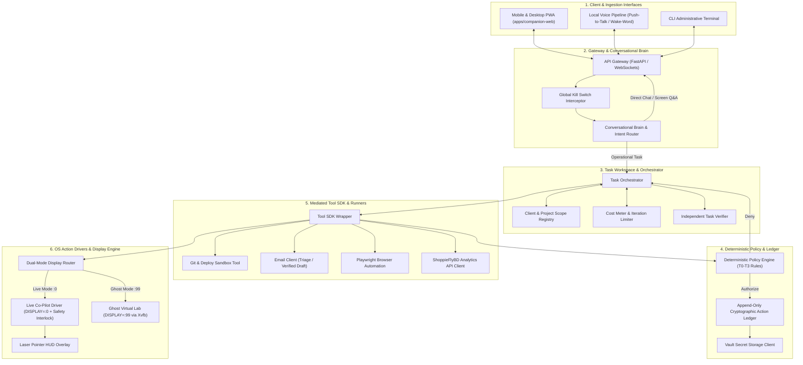

# Igris Architecture Specification (ARCHITECTURE.md)

> **Document Version:** 2.0.0  
> **System Scope:** Supervised Multi-Modal Autonomous OS Operator & Operations Assistant  
> **Classification:** Living Architecture Specification

---

## 1. Multi-Tier End-to-End System Topology

---

## 2. Subsystem Boundaries and Responsibilities

### 2.1 Gateway & Conversational Intent Router
- **Role:** Central communications hub hosting authenticated WebSockets and REST endpoints.
- **Intent Classifier:** Distinguishes between:
  1. *Conversational Inquiries & Greetings:* Handled directly by LLM chat synthesis and Edge-TTS voice playback without launching desktop applications.
  2. *Screen Perception Q&A:* Inspects active display frame via MSS and AT-SPI to describe screen elements without executing mutating actions.
  3. *Computer Operating Tasks:* Routes to the Task Orchestrator with an initialized `TaskContext`.

### 2.2 Task Orchestration & Workspace Scoping
- **Role:** Manages the lifecycle of actionable tasks.
- **Scoping Invariant:** Binds each task to a specific `ClientScope` defined in `packages/registry`. Cross-project data leakage is structurally impossible.
- **Mode Enforcer:**
  - `TRIAGE`: Restricts active tools to read-only interfaces.
  - `WORK`: Launches isolated work branches/containers and coordinates the Independent Verifier.

### 2.3 Deterministic Policy Engine & Immutable Ledger
- **Role:** The non-negotiable security core of Igris.
- **Architecture:** Implemented as pure functions without external I/O or LLM reasoning.
- **Enforcement:**
  - Blocks any T2 or T3 action if not accompanied by an unexpired, cryptographically signed `ApprovalToken`.
  - Appends an immutable, hash-chained record of all invocations to the SQL `action_ledger` table.

### 2.4 Mediated Tool SDK & Runners
- **Role:** Sandboxed execution interfaces for filesystem, git, email, browser, and third-party APIs.
- **Rule:** No tool can be invoked directly by the agent; all calls route through `tool_sdk.invoke()`, guaranteeing policy inspection and ledger logging before and after every execution.

### 2.5 Dual-Mode OS Drivers
- **Live Co-Pilot Mode (`DISPLAY=:0`):** Operates on the primary screen alongside the user with hardware mouse/escape safety interlocks and HUD laser visualization.
- **Ghost Virtual Lab Mode (`DISPLAY=:99`):** Executes complex, headless, or background multi-step workflows on an Xvfb virtual framebuffer with zero desktop interruption.
